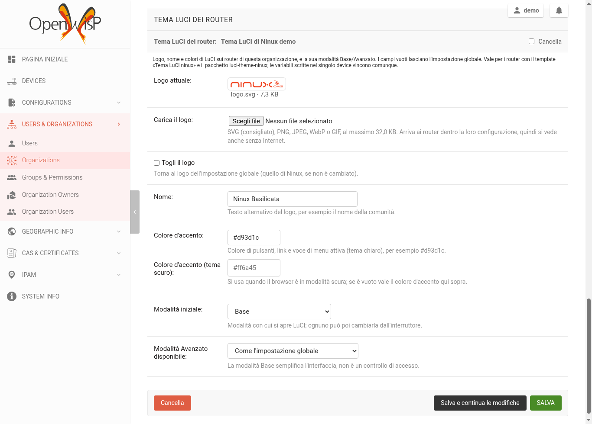

# openwisp-luci-theme

[🇬🇧 English](README.md) | 🇮🇹 Italiano

> 📖 Questo repository fa parte dell'infrastruttura di **NINUX Basilicata**: la guida per ricostruirla tutta, passo passo (Proxmox, DNS, OpenWISP, moduli, firmware, app), è su **[GitHub Pages](https://mikysal78.github.io/ninux-basilicata-infra/)**.

[](https://github.com/mikysal78/openwisp-luci-theme/actions/workflows/ci.yml)

Un riquadro **Tema LuCI dei router** nella pagina dell'organizzazione di
[OpenWISP](https://openwisp.org/): ogni organizzazione sceglie **logo** (con
l'upload), **nome**, **colori** e **modalità Base/Avanzato** di LuCI sui suoi
router, per il tema [luci-theme-ninux](https://github.com/mikysal78/luci-theme-ninux).



## Come funziona

Ai router le impostazioni del tema arrivano con il template OpenWISP **Tema LuCI
ninux** ([`luci-theme-ninux.json`](integration/luci-theme-ninux.json), lo stesso
del repo `openwisp2`), che scrive la sezione UCI `luci.ninux` dalle variabili
`luci_logo`, `luci_brand`, `luci_accent`, `luci_accent_dark`, `luci_mode` e
`luci_allow_advanced`.

Il modulo aggiunge queste variabili alla configurazione di ogni device
dell'organizzazione, con l'aggancio ufficiale `Config.register_context_function`.
Da dove arrivano, in ordine (vince l'ultimo):

1. contesto globale (`OPENWISP_CONTROLLER_CONTEXT`);
2. *Configuration variables* dell'organizzazione, poi del gruppo di device;
3. **il riquadro di questo modulo** (solo i campi compilati);
4. variabili del singolo device.

Un campo vuoto lascia il valore che arriva da sopra. Salvando il riquadro si
ricalcola il checksum della configurazione dei device dell'organizzazione (con
lo stesso task che OpenWISP usa quando cambiano le variabili
dell'organizzazione), così i router scaricano la configurazione nuova al
controllo successivo.

**Il logo** arriva al router **dentro la sua configurazione** come `data:` URI,
non come link: si vede anche quando chi apre LuCI non raggiunge Internet né il
server OpenWISP, e non c'è niente da pubblicare. In cambio pesa: finisce in
`/etc/config/luci` e in ogni pagina di LuCI, per questo c'è un limite di
dimensione (32 KB di default) e l'ideale è un SVG piccolo. Il tipo di file si
riconosce dai suoi byte (SVG, PNG, JPEG, WebP, GIF); gli SVG con script,
gestori di eventi, riferimenti esterni o entità vengono rifiutati.

La modalità Base semplifica l'interfaccia: **non è un controllo di accesso**.

## Installazione

Serve openwisp-controller ≥ 1.1 (provato con la 1.3.2) e, sui router, il
pacchetto `luci-theme-ninux`.

1. Installa il pacchetto nel virtualenv di OpenWISP:

   ```sh
   pip install https://github.com/mikysal78/openwisp-luci-theme/releases/download/v0.1.0/openwisp_luci_theme-0.1.0-py3-none-any.whl
   ```

2. Aggiungilo a `INSTALLED_APPS` **dopo** `openwisp_users` e
   `openwisp_controller.config` (estende l'admin dell'organizzazione che
   registrano), poi `python manage.py migrate`. Con il ruolo
   [ansible-openwisp2](https://github.com/openwisp/ansible-openwisp2):

   ```yaml
   openwisp2_extra_django_apps:
     - "openwisp_luci_theme"
   openwisp2_extra_python_packages:
     - "openwisp-luci-theme @ git+https://github.com/mikysal78/openwisp-luci-theme@v0.1.0"
   ```

3. Importa il template **Tema LuCI ninux** e assegnalo ai router. Il template
   **non ha default values**: OpenWISP li copierebbe nelle variabili di ogni
   device, dove vincerebbero sul riquadro dell'organizzazione. I valori per
   tutti vanno invece nel contesto globale:

   ```python
   OPENWISP_CONTROLLER_CONTEXT = {
       "luci_logo": "/luci-static/ninux/logo.svg",
       "luci_brand": "ninux",
       "luci_accent": "",
       "luci_accent_dark": "",
       "luci_mode": "basic",
       "luci_allow_advanced": "1",
   }
   ```

Impostazioni:

| Impostazione | Default | Significato |
|---|---|---|
| `OPENWISP_LUCI_THEME_MAX_LOGO_SIZE` | `32768` | dimensione massima del logo, in byte |

Permessi: i superuser e i membri del gruppo **Administrator** di OpenWISP
(aggiunta, modifica, eliminazione), che la migrazione assegna; **Operator** può
solo vedere. Come per ogni impostazione dell'organizzazione, un amministratore
vede solo le organizzazioni che gestisce.

## Sviluppo

```sh
pip install pytest ruff
pytest                      # logo e variabili, senza OpenWISP
ruff check . && ruff format --check .
# dentro un OpenWISP vero (progetto di test di openwisp-controller, SpatiaLite):
pip install "openwisp-controller==1.3.2" "django~=5.2.0"
integration/run.sh 1.3.2
```

La traduzione italiana è in `openwisp_luci_theme/locale/it/`: dopo aver cambiato
le stringhe, `django-admin makemessages -l it` e `msgfmt` (la CI controlla che il
`.mo` sia aggiornato).

## Segnalare vulnerabilità

Vedi [SECURITY.md](SECURITY.md).

## Licenza

GPL-3.0-or-later, come OpenWISP.
