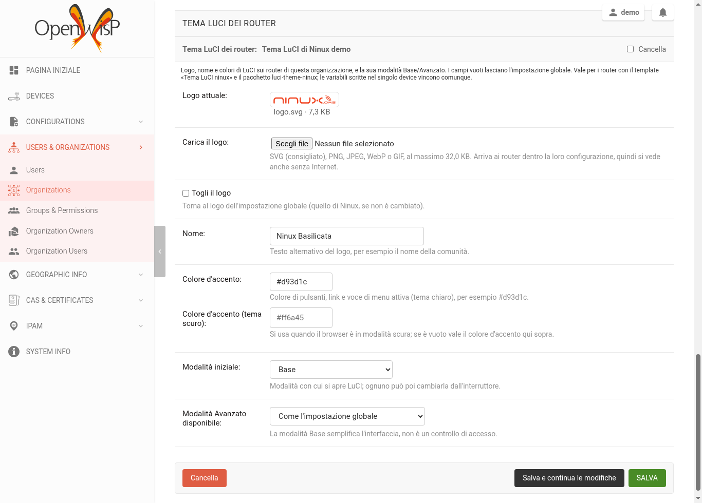

# openwisp-luci-theme

🇬🇧 English | [🇮🇹 Italiano](README.it.md)

> 📖 This repository is part of the **NINUX Basilicata** infrastructure: the step-by-step guide to rebuild all of it (Proxmox, DNS, OpenWISP, modules, firmware, app) is on **[GitHub Pages](https://mikysal78.github.io/ninux-basilicata-infra/en/)**.

[](https://github.com/mikysal78/openwisp-luci-theme/actions/workflows/ci.yml)

A **LuCI theme of the routers** box on the organization page of
[OpenWISP](https://openwisp.org/): every organization picks the **logo** (upload),
**name**, **colors** and **Basic/Advanced mode** of LuCI on its routers, for the
[luci-theme-ninux](https://github.com/mikysal78/luci-theme-ninux) theme.



## How it works

The routers get the theme settings through the OpenWISP template **Tema LuCI
ninux** ([`luci-theme-ninux.json`](integration/luci-theme-ninux.json), also in
the `openwisp2` repository), which writes the `luci.ninux` UCI section from the
variables `luci_logo`, `luci_brand`, `luci_accent`, `luci_accent_dark`,
`luci_mode` and `luci_allow_advanced`.

This module adds those variables to the configuration of every device of the
organization, with the official hook `Config.register_context_function`. Where
they come from, in order (the last one wins):

1. global context (`OPENWISP_CONTROLLER_CONTEXT`);
2. *Configuration variables* of the organization, then of the device group;
3. **the box of this module** (only the fields that are set);
4. variables of the single device.

An empty field keeps the value from above. Saving the box recomputes the
configuration checksum of the organization's devices (the same task OpenWISP
uses when organization variables change), so the routers download the new
configuration at their next check.

**The logo** is sent to the router **inside its configuration** as a `data:`
URI, not as a link: it is shown even when whoever opens LuCI cannot reach the
Internet or the OpenWISP server, and nothing has to be served publicly. The
price is weight (it ends up in `/etc/config/luci` and in every LuCI page), hence
the size limit (32 KB by default): a small SVG is ideal. The file type is
checked from its bytes (SVG, PNG, JPEG, WebP, GIF); SVGs with scripts, event
handlers, external references or entities are rejected.

Basic mode simplifies the interface: it is **not access control**.

## Installation

Requires openwisp-controller ≥ 1.1 (tested with 1.3.2) and, on the routers,
the `luci-theme-ninux` package.

1. Install the package in the OpenWISP virtualenv:

   ```sh
   pip install https://github.com/mikysal78/openwisp-luci-theme/releases/download/v0.1.0/openwisp_luci_theme-0.1.0-py3-none-any.whl
   ```

2. Add it to `INSTALLED_APPS` **after** `openwisp_users` and
   `openwisp_controller.config` (it extends the organization admin they
   register), then `python manage.py migrate`. With the
   [ansible-openwisp2](https://github.com/openwisp/ansible-openwisp2) role:

   ```yaml
   openwisp2_extra_django_apps:
     - "openwisp_luci_theme"
   openwisp2_extra_python_packages:
     - "openwisp-luci-theme @ git+https://github.com/mikysal78/openwisp-luci-theme@v0.1.0"
   ```

3. Import the **Tema LuCI ninux** template and assign it to the routers. The
   template has **no default values**: OpenWISP would copy them into the
   variables of each device, where they would win over the organization box.
   Put the defaults for everyone in the global context instead:

   ```python
   OPENWISP_CONTROLLER_CONTEXT = {
       "luci_logo": "/luci-static/ninux/logo.svg",
       "luci_brand": "ninux",
       "luci_accent": "",
       "luci_accent_dark": "",
       "luci_mode": "basic",
       "luci_allow_advanced": "1",
   }
   ```

Settings:

| Setting | Default | Meaning |
|---|---|---|
| `OPENWISP_LUCI_THEME_MAX_LOGO_SIZE` | `32768` | maximum logo size, in bytes |

Permissions: superusers, and members of the OpenWISP **Administrator** group
(add, change, delete), which the migration grants; **Operator** can only view.
As for every organization setting, a manager only sees the organizations they
manage.

## Development

```sh
pip install pytest ruff
pytest                      # logo and variables, no OpenWISP needed
ruff check . && ruff format --check .
# inside a real OpenWISP (openwisp-controller test project, SpatiaLite):
pip install "openwisp-controller==1.3.2" "django~=5.2.0"
integration/run.sh 1.3.2
```

The Italian translation is in `openwisp_luci_theme/locale/it/`: after changing
the strings, `django-admin makemessages -l it` and `msgfmt` (CI checks that the
`.mo` is up to date).

## Reporting vulnerabilities

See [SECURITY.md](SECURITY.md).

## License

GPL-3.0-or-later, like OpenWISP.
